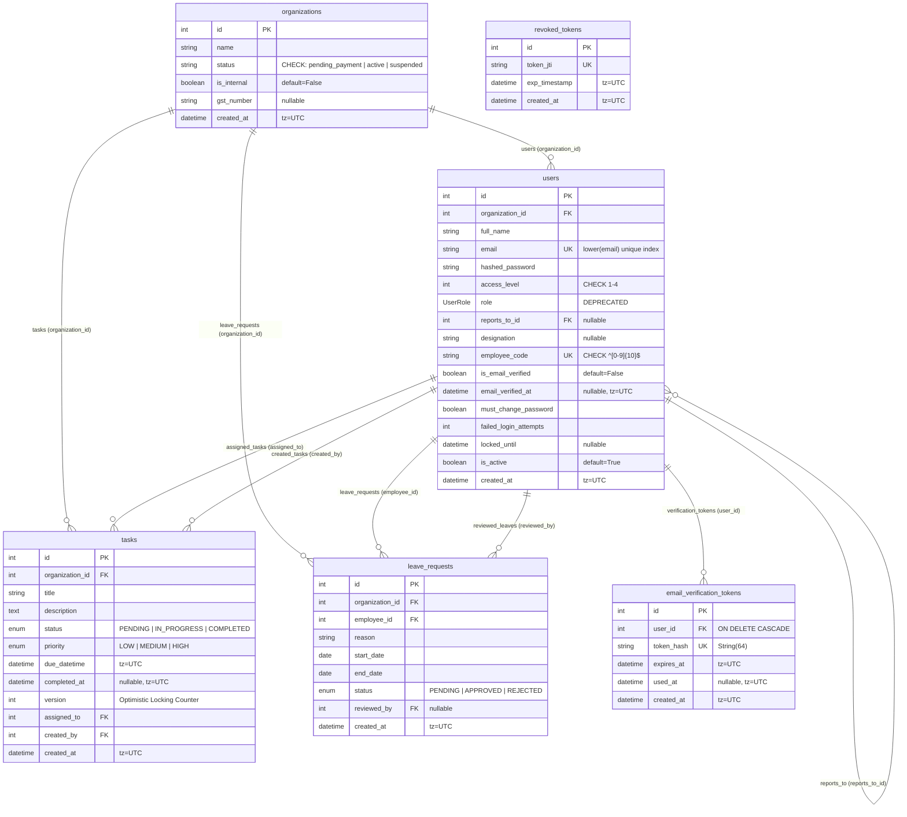

# Backend Architecture & Technical Reference

This document provides the authoritative technical reference for the Employee Task Management System's FastAPI backend service.

---

## 1. Tech Stack & Dependencies

The backend is built with Python 3.11+ using an asynchronous architecture across web, database, and background layers.

| Package | Version Constraint | Purpose |
|---|---|---|
| **fastapi** | `>=0.110.0` | Asynchronous ASGI Web Framework |
| **uvicorn** | `>=0.28.0` | High-performance ASGI Web Server |
| **sqlalchemy** | `>=2.0.28` | Async ORM & SQL Query Builder (Declarative 2.0 style) |
| **asyncpg** | `>=0.29.0` | High-performance async PostgreSQL driver |
| **alembic** | `>=1.13.1` | Database Schema Migrations |
| **bcrypt** | `>=4.1.2` | Secure password hashing (`gensalt()`, `hashpw()`, `checkpw()`) |
| **pyjwt[crypto]** | `>=2.8.0` | JSON Web Token encode/decode with HMAC-SHA256 |
| **pydantic** | `>=2.6.4` | Data validation, type coercion, and serialization (v2) |
| **email-validator** | `>=2.1.0` | Email string validation for Pydantic `EmailStr` |
| **pydantic-settings** | `>=2.2.1` | Type-safe settings management via `.env` files |
| **python-dotenv** | `>=1.0.1` | Environment variable management |
| **python-multipart** | `>=0.0.7` | Form-data parsing for OAuth2 password request forms |

---

## 2. Directory Structure & File Map

```text
app/
├── core/
│   ├── config.py            # Pydantic Settings class loading env vars (DB URL, JWT secrets, SMTP, CORS)
│   ├── email.py             # EmailSender interface (SMTPEmailSender, ConsoleEmailSender) and transactional dispatch for verification links and employee onboarding welcome emails
│   ├── exceptions.py        # Central domain exception hierarchy (AppException, NotFound, Auth, OptimisticLockException, etc.)
│   ├── permissions.py       # Permission module documentation and access level specifications
│   ├── rate_limit.py        # RateLimiter abstract interface and InMemoryRateLimiter sliding-window implementation
│   ├── scheduler.py         # APScheduler background tasks (daily expired token cleanup, 7-day unverified signup cleanup)
│   └── security.py          # Password hashing, JWT token issuance/decoding, token blacklist verification, auth dependencies
├── db/
│   ├── base.py              # Async SQLAlchemy engine, AsyncSessionLocal sessionmaker, and Base declarative model
│   └── session.py           # get_db FastAPI dependency yielding AsyncSession per request
├── models/
│   ├── email_verification_token.py # EmailVerificationToken ORM model for email verification tokens
│   ├── leave.py             # LeaveRequest ORM model and LeaveStatus enum
│   ├── organization.py      # Organization ORM model (status check constraint, is_internal, gst_number)
│   ├── revoked_token.py     # RevokedToken ORM model for JWT invalidation blacklist
│   ├── task.py              # Task ORM model with optimistic locking version, TaskStatus enum, and TaskPriority enum
│   └── user.py              # User ORM model with access_level tier (1-4), 10-digit numeric ID, email verification columns, and deprecated UserRole enum
├── routes/
│   ├── analytics.py         # /analytics router (PerformanceStats calculation with hierarchy-aware scoping)
│   ├── auth.py              # /auth router (signup, verify-email, resend-verification, login, swagger-login, refresh, logout, change-password)
│   ├── leaves.py            # /leaves router (submit leave, list leaves, list team leaves, review leave)
│   ├── tasks.py             # /tasks router (create task, list tasks, list team tasks, update task, delete task)
│   └── users.py             # /users router (me, me/reports, patch me, list employees, create employee, reset password, update manager)
├── schemas/
│   ├── analytics.py         # Pydantic models: PerformanceStats, TrailItem
│   ├── leave.py             # Pydantic models: LeaveCreate, LeaveRead, LeaveUpdateStatus
│   ├── task.py              # Pydantic models: TaskCreate, TaskRead (with version), TaskUpdate (requires version), TaskUpdateStatus (requires version)
│   └── user.py              # Pydantic models: UserRead (with access_level, effective_tier, direct_reports_ids, is_email_verified), UserLogin, SignupRequest, EmailVerificationRequest, ResendVerificationRequest, EmployeeCreate, EmployeeCreateResponse, PasswordChange, Token
├── services/
│   ├── analytics_service.py # Scoped aggregation metrics calculations (self, team, org)
│   ├── auth_service.py      # Authentication, signup, email verification, dual-token revocation, lockout verification, and token rotation
│   ├── common.py            # Central get_scoped_or_404 multi-tenant resource resolution helper
│   ├── leave_service.py     # Leave request management, date range overlap validation, and team leave retrieval
│   ├── permission_service.py# Direct reporting relationship checks (can_manage_specific_user), tier resolution, relationship caching, route dependencies
│   ├── task_service.py      # Task management with HTTP-safe optimistic concurrency control and eager loading
│   └── user_service.py      # Employee provisioning with 10-digit random User ID generator and collision retry, supervisor cycle detection, and orphan cleanup
└── main.py                  # FastAPI application bootstrap, CORS middleware, router registration, exception handlers
alembic/
├── env.py                   # Async Alembic execution environment configuring target metadata
├── script.py.mako           # Migration script template
└── versions/                # Database migration version files (f2850ec5859c -> n4o5p6q7r8s9)
scripts/
├── diagnose_users.py        # Idempotent diagnostic CLI inspecting live users, hierarchy, lockouts, and user IDs
├── reset_passwords.py       # Administrative CLI utility for password updates and verification
├── run_qa_suite.py          # Automated HTTP API test script executing functional test cases
├── seed_admin.py            # CLI script for seeding initial ADMIN user
├── test_endpoints.py        # Lightweight endpoint smoke testing script
└── unlock_user.py           # Administrative CLI utility to unlock locked employee accounts
tests/
├── conftest.py              # Pytest async fixtures (PostgreSQL test DB, Alembic migrations, AsyncClient, auth headers, rate-limit reset)
├── test_analytics.py        # Unit and integration tests for performance analytics and scoping
├── test_auth.py             # Tests for signup, email verification, resend verification, login modes, token refresh rotation, dual-token logout revocation, password change
├── test_concurrency.py     # Concurrency smoke tests for 10-digit random User IDs and optimistic locking under parallel load
├── test_direct_report_scoping.py # Tests for manager-direct report task and leave scoping rules
├── test_employee_creation.py# Tests for 10-digit numeric User ID generation, collision retries, and legacy format rejection
├── test_leaves.py           # Tests for personal leave submission, team leave listing (all statuses), and admin review workflows
├── test_login_security.py   # Tests for account lockout, rate limiting, and generic error uniformity
├── test_rbac.py             # Tests for access level enforcement and direct reporting delegation boundaries
├── test_services.py         # Direct domain service layer unit tests
├── test_slice2_migration.py # Acceptance test for Slice 2 migration, backfill, and downgrade reversibility
├── test_slice2_organizations.py # Unit and relationship tests for Organization model and creation paths
├── test_slice3_isolation.py # Acceptance tests for tenant isolation and 404 anti-enumeration
├── test_slice4a_migration.py # Acceptance test for Slice 4a migration, 10-digit numeric IDs, email verification, lower(email) unique index, and reversibility
├── test_tasks.py            # Tests for task CRUD, optimistic locking conflict detection (HTTP 409), and completed_at timestamps
└── test_users.py            # Tests for user profile routes, access levels, and supervisory hierarchy updates
```

---

## 3. Database Models & Schema Specifications

The database schema is managed through SQLAlchemy 2.0 Declarative Base (`app.db.base.Base`) with PostgreSQL as the target database engine.



### 3.1 Model: `Organization` (`app/models/organization.py` -> `organizations` table)

| Column Name | Type | Constraints / Default | Description |
|---|---|---|---|
| `id` | `Integer` | Primary Key, Indexed | Unique internal tenant organization ID |
| `name` | `String(255)` | Non-nullable | Legal/trading organization name |
| `status` | `String(50)` | CheckConstraint (`pending_payment`, `active`, `suspended`), default=`active` | Lifecycle operational status |
| `is_internal` | `Boolean` | Non-nullable, default=`False` | Flag indicating internal Teamloom root tenant ("Internal / free forever") |
| `gst_number` | `String(15)` | Nullable, default=`None` | Optional Indian GSTIN registration number |
| `created_at` | `DateTime(timezone=True)` | Non-nullable, server_default=`func.now()` | Organization creation timestamp |

### 3.2 Model: `User` (`app/models/user.py` -> `users` table)

| Column Name | Type | Constraints / Default | Description |
|---|---|---|---|
| `id` | `Integer` | Primary Key, Indexed | Unique internal user ID |
| `organization_id` | `Integer` | Foreign Key (`organizations.id`, `ondelete="CASCADE"`), Indexed, Non-nullable | Tenant organization ID |
| `full_name` | `String` | Non-nullable | Full name of the user |
| `email` | `String` | Unique (`lower(email)` unique index), Indexed, Non-nullable | User email address (system-wide unique, normalized to lowercase) |
| `hashed_password` | `String` | Non-nullable | Bcrypt hashed password string |
| `access_level` | `Integer` | CheckConstraint (`1-4`), Non-nullable, default=`3` | Operational access tier: 1 (Admin/Exec), 2 (Manager), 3 (Team Lead), 4 (Associate). Tier 1 has full administrative bypass; for non-admins, delegation is governed by `reports_to_id`. |
| `role` | `SQLEnum(UserRole)` | Deprecated, default=`EMPLOYEE` | Retained for backward compatibility (`ADMIN` or `EMPLOYEE`) |
| `reports_to_id` | `Integer` | Foreign Key (`users.id`, `ondelete="SET NULL"`), Nullable | Direct supervisor's user ID |
| `designation` | `String(255)` | Nullable, default=`None` | Free-text cosmetic job title (e.g. "Senior Engineer"); carries zero permission effect |
| `employee_code` | `String(10)` | Unique, Indexed, Nullable, CheckConstraint (`employee_code IS NULL OR employee_code ~ '^[0-9]{10}$'`) | 10-digit random numeric string identifier (e.g. `1000001001`) |
| `is_email_verified` | `Boolean` | Non-nullable, default=`False` | Email verification status flag |
| `email_verified_at` | `DateTime(timezone=True)` | Nullable, default=`None` | Timestamp when user email was verified |
| `must_change_password` | `Boolean` | Non-nullable, default=`False` | Forces password change before API access |
| `failed_login_attempts` | `Integer` | Non-nullable, default=`0` | Counter for consecutive bad password logins |
| `locked_until` | `DateTime(timezone=True)` | Nullable, default=`None` | Timestamp until which the account is locked |
| `is_active` | `Boolean` | Non-nullable, default=`True` | Active status flag; inactive accounts are blocked from login and excluded from team views |
| `created_at` | `DateTime(timezone=True)` | Non-nullable, server_default=`func.now()` | Account creation timestamp |

### 3.3 Model: `Task` (`app/models/task.py` -> `tasks` table)

| Column Name | Type | Constraints / Default | Description |
|---|---|---|---|
| `id` | `Integer` | Primary Key, Indexed | Unique task ID |
| `organization_id` | `Integer` | Foreign Key (`organizations.id`, `ondelete="CASCADE"`), Indexed, Non-nullable | Tenant organization ID |
| `title` | `String` | Non-nullable | Brief summary of the task |
| `description` | `Text` | Non-nullable | Detailed task requirements |
| `status` | `SQLEnum(TaskStatus)` | Non-nullable, default=`PENDING` | `PENDING`, `IN_PROGRESS`, `COMPLETED` |
| `priority` | `SQLEnum(TaskPriority)` | Non-nullable | `LOW`, `MEDIUM`, `HIGH` |
| `due_datetime` | `DateTime(timezone=True)` | Non-nullable | Exact deadline timestamp with timezone |
| `completed_at` | `DateTime(timezone=True)` | Nullable, default=`None` | Timestamp recorded when marked `COMPLETED` |
| `version` | `Integer` | Non-nullable, default=`1` | Optimistic concurrency locking counter incremented on every update |
| `is_deleted` | `Boolean` | Non-nullable, default=`False`, server_default=`false` | Soft-delete flag; soft-deleted tasks are hidden across all active endpoints |
| `deleted_at` | `DateTime(timezone=True)` | Nullable, default=`None` | Timestamp when the task was soft-deleted |
| `deleted_by` | `Integer` | Foreign Key (`users.id`, `ondelete="SET NULL"`), Nullable | User ID of the admin who soft-deleted the task |
| `assigned_to` | `Integer` | Foreign Key (`users.id`, `ondelete="CASCADE"`), Non-nullable | Assignee user ID |
| `created_by` | `Integer` | Foreign Key (`users.id`, `ondelete="CASCADE"`), Non-nullable | Creator user ID |
| `created_at` | `DateTime(timezone=True)` | Non-nullable, server_default=`func.now()` | Task creation timestamp |

### 3.4 Model: `LeaveRequest` (`app/models/leave.py` -> `leave_requests` table)

| Column Name | Type | Constraints / Default | Description |
|---|---|---|---|
| `id` | `Integer` | Primary Key, Indexed | Unique leave request ID |
| `organization_id` | `Integer` | Foreign Key (`organizations.id`, `ondelete="CASCADE"`), Indexed, Non-nullable | Tenant organization ID |
| `employee_id` | `Integer` | Foreign Key (`users.id`, `ondelete="CASCADE"`), Non-nullable | Applicant user ID |
| `reason` | `String` | Non-nullable | Statement of reason for absence |
| `start_date` | `Date` | Non-nullable | Absence start date |
| `end_date` | `Date` | Non-nullable | Absence end date (must be `>= start_date`) |
| `status` | `SQLEnum(LeaveStatus)` | Non-nullable, default=`PENDING` | `PENDING`, `APPROVED`, `REJECTED` |
| `reviewed_by` | `Integer` | Foreign Key (`users.id`, `ondelete="SET NULL"`), Nullable | Admin who reviewed (approval is Tier 1 Admin only) |
| `created_at` | `DateTime(timezone=True)` | Non-nullable, server_default=`func.now()` | Submission timestamp |

### 3.5 Model: `RevokedToken` (`app/models/revoked_token.py` -> `revoked_tokens` table)

| Column Name | Type | Constraints / Default | Description |
|---|---|---|---|
| `id` | `Integer` | Primary Key, Indexed | Unique revocation record ID |
| `token_jti` | `String(255)` | Unique, Indexed, Non-nullable | Unique JWT ID (`jti`) |
| `exp_timestamp` | `DateTime(timezone=True)` | Indexed, Non-nullable | Expiration timestamp of the revoked token |
| `created_at` | `DateTime(timezone=True)` | Non-nullable, server_default=`func.now()` | Revocation timestamp |

### 3.6 Model: `EmailVerificationToken` (`app/models/email_verification_token.py` -> `email_verification_tokens` table)

| Column Name | Type | Constraints / Default | Description |
|---|---|---|---|
| `id` | `Integer` | Primary Key, Indexed | Unique verification token record ID |
| `user_id` | `Integer` | Foreign Key (`users.id`, `ondelete="CASCADE"`), Indexed, Non-nullable | Associated user ID |
| `token_hash` | `String(64)` | Unique, Non-nullable | SHA-256 hash of the verification token |
| `expires_at` | `DateTime(timezone=True)` | Non-nullable | Token expiration timestamp (default 24h) |
| `used_at` | `DateTime(timezone=True)` | Nullable, default=`None` | Timestamp when token was consumed |
| `created_at` | `DateTime(timezone=True)` | Non-nullable, server_default=`func.now()` | Creation timestamp |

---

## 4. API Route Reference

### 4.1 Authentication Router (`app/routes/auth.py` -> `/auth`)

| Method | Path | Auth / Role Requirement | Request Schema | Response Schema / Status | Description |
|---|---|---|---|---|---|
| `POST` | `/auth/signup` | Public (IP Rate limited: 10/15min) | `SignupRequest` (`company_name`, `full_name`, `email`, `password`) | `SignupResponse` (201 Created) | Self-serve signup (FR-2, A6). Creates Organization (`pending_payment`) and Tier-1 Admin (`access_level=1`, `is_email_verified=False`). Dispatches verification link via background task. Anti-enumeration: returns identical 201 for duplicate email. Does not return auth tokens. |
| `POST` | `/auth/verify-email` | Public (POST-only) | `EmailVerificationRequest` (`token: str`) | `EmailVerificationResponse` (200 OK) | Consumes single-use verification token (FR-2, X2), marks `is_email_verified=True` and `email_verified_at=now`. Generic error for invalid/expired tokens. |
| `POST` | `/auth/resend-verification` | Public (IP Rate limited: 10/15min) | `ResendVerificationRequest` (`email: str`) | `ResendVerificationResponse` (200 OK) | Generates new verification token, invalidates older unused tokens, and sends verification link. Anti-enumeration: identical generic 200 returned for unknown or already-verified emails. |
| `POST` | `/auth/login` | Public (IP Rate limited: 10/15min) | `UserLogin` (`identifier: str`, `password: str`, `mode: "admin" \| "employee"`) | `Token` (200 OK) + `refresh_token` httpOnly cookie | Authenticate via dual mode (`admin`: email & `access_level == 1`; `employee`: User ID & `access_level > 1`). Enforces email verification for admins. Returns generic error `"Incorrect credentials."` (401) on failure. |
| `POST` | `/auth/swagger-login` | Public (Form-data) | `OAuth2PasswordRequestForm` | `Token` (200 OK) | Form-based login for Swagger UI Authorize modal. Maps `@` in username to admin mode, digits to employee mode. |
| `POST` | `/auth/refresh` | `refresh_token` cookie | None (reads cookie) | `Token` (200 OK) + rotated cookie | Rotate refresh token; revokes the old refresh token in DB, verifies token is not revoked |
| `POST` | `/auth/logout` | Bearer Token (`oauth2_scheme`) | None | `{"message": "Logged out successfully"}` (200 OK) | Revokes BOTH the access token's `jti` and refresh token's `jti` in DB and clears cookie |
| `POST` | `/auth/change-password` | Bearer Token (Allows `must_change_password=True`) | `PasswordChange` (`current_password`, `new_password`) | `UserRead` (200 OK) | Update password and clear `must_change_password` flag |

### 4.2 Users Router (`app/routes/users.py` -> `/users`)

| Method | Path | Auth / Role Requirement | Query Params | Request Schema | Response Schema / Status | Description |
|---|---|---|---|---|---|---|
| `GET` | `/users/me` | Bearer Token (Password change cleared) | None | None | `UserRead` (200 OK) | Get authenticated user profile with access_level and direct_reports_ids |
| `GET` | `/users/me/reports` | Bearer Token (Password change cleared) | `skip: int = 0`, `limit: int = 100` | None | `list[UserRead]` (200 OK, `X-Total-Count` header) | Get active direct reports of authenticated user in their organization |
| `GET` | `/users/{user_id}/direct-reports` | Tier 1 (Admin) OR Supervisor self | `skip: int = 0`, `limit: int = 100` | None | `list[UserRead]` (200 OK, `X-Total-Count` header) | Get active direct reports for specific user (org-scoped 404 for cross-tenant) |
| `PATCH` | `/users/me` | Bearer Token (Password change cleared) | None | `UserUpdate` (`full_name`, `designation`) | `UserRead` (200 OK) | Update user's own display profile |
| `GET` | `/users/` | `check_access_level_dependency(1)` (Admin) | `skip: int = 0`, `limit: int = 100` | None | `list[UserRead]` (200 OK, `X-Total-Count` header) | List all employees in the admin's organization |
| `POST` | `/users/employees` | `check_access_level_dependency(1)` (Admin) | None | `EmployeeCreate` (`full_name`, `email`, `reports_to_id`, `designation`, `access_level`) | `EmployeeCreateResponse` (201 Created) | Provision employee with 10-digit random User ID & temp password within admin's org. Bcrypt password hashing is offloaded via `asyncio.to_thread` and welcome email is dispatched in `BackgroundTasks`. `email_sent` indicates delivery was queued. |
| `POST` | `/users/{user_id}/reset-temp-password` | `check_access_level_dependency(1)` (Admin) | None | None | `{"id": int, "email_sent": bool}` (200 OK) | Reset employee password to new temporary password and dispatch email in `BackgroundTasks` off the event loop (`email_sent` indicates delivery was queued; org-scoped 404). |
| `PATCH` | `/users/{user_id}/reports-to` | `check_access_level_dependency(1)` (Admin) | None | `UserReportsToUpdate` (`reports_to_id`) | `UserRead` (200 OK) | Assign or update employee's supervisor (org-scoped, cycle-checked) |
| `PATCH` | `/users/{user_id}/deactivate` | `check_access_level_dependency(1)` (Admin) | None | `UserDeactivateRequest` (optional) | `UserRead` (200 OK) / HTTP 409 Conflict | Deactivate employee. If user has active direct reports, requires explicit subordinate reassignments or explicit 'no manager' (null), otherwise returns HTTP 409 with unresolved subordinates list |
| `PATCH` | `/users/{user_id}/reactivate` | `check_access_level_dependency(1)` (Admin) | None | None | `UserRead` (200 OK) | Reactivate employee within admin's organization |

### 4.3 Tasks Router (`app/routes/tasks.py` -> `/tasks`)

| Method | Path | Auth / Role Requirement | Query / Path Params | Request Schema | Response Schema / Status | Description |
|---|---|---|---|---|---|---|
| `POST` | `/tasks/` | Tier 1 (Admin) OR Direct Supervisor of Assignee (`reports_to_id == actor.id`) | None | `TaskCreate` | `TaskRead` (201 Created) | Create and assign task to employee within caller's organization |
| `GET` | `/tasks/team` | Bearer Token (Password change cleared) | `status`, `priority`, `sort_by`, `skip`, `limit` (max 100) | None | `list[TaskRead]` (200 OK, `X-Total-Count` header) | List tasks assigned to caller's direct reports in their org |
| `GET` | `/tasks/` | Bearer Token (Password change cleared) | `status`, `priority`, `sort_by`, `skip`, `limit` (max 100) | None | `list[TaskRead]` (200 OK, `X-Total-Count` header) | List tasks (Admin: all in org, Employee: self) |
| `GET` | `/tasks/{id}` | Bearer Token (Admin or Assignee) | `id: int` | None | `TaskRead` (200 OK) | Fetch single task details (org-scoped 404 for cross-tenant) |
| `PATCH` | `/tasks/{id}` | Bearer Token (Admin: all fields, Employee: status only) | `id: int` | `TaskUpdate` (requires `version: int`) | `TaskRead` (200 OK) | Update task fields / status (org-scoped 404 for cross-tenant; 409 Conflict on version mismatch) |
| `DELETE` | `/tasks/{id}` | `check_access_level_dependency(1)` (Admin) | `id: int` | None | 204 No Content | Soft-delete task (sets `is_deleted=True`, `deleted_at`, `deleted_by`, bumps `version`; org-scoped 404 for cross-tenant / already-deleted) |

### 4.4 Leaves Router (`app/routes/leaves.py` -> `/leaves`)

| Method | Path | Auth / Role Requirement | Query Params | Request Schema | Response Schema / Status | Description |
|---|---|---|---|---|---|
| `POST` | `/leaves/` | Bearer Token (Password change cleared) | None | `LeaveCreate` | `LeaveRead` (201 Created) | Submit a personal leave request in caller's organization |
| `GET` | `/leaves/` | Bearer Token (Password change cleared) | `status`, `sort_by`, `skip`, `limit` (max 100) | None | `list[LeaveRead]` (200 OK, `X-Total-Count` header) | List personal leaves (Admin: all in org, Employee: self) |
| `GET` | `/leaves/team` | Bearer Token (Password change cleared) | `status`, `sort_by`, `skip`, `limit` (max 100) | None | `list[LeaveRead]` (200 OK, `X-Total-Count` header) | View-only list of leave requests from active direct reports in org |
| `PATCH` | `/leaves/{id}` | `check_access_level_dependency(1)` (Tier 1 Admin ONLY) | `id: int` | `LeaveUpdateStatus` | `LeaveRead` (200 OK) | Approve or reject a leave request within admin's org (org-scoped 404) |

### 4.5 Analytics Router (`app/routes/analytics.py` -> `/analytics`)

| Method | Path | Auth / Role Requirement | Query Params | Request Schema | Response Schema / Status | Description |
|---|---|---|---|---|---|
| `GET` | `/analytics/performance` | Bearer Token (Password change cleared) | `employee_id: int | None`, `trail_limit: int = 10` | None | `PerformanceStats` (200 OK) | Compute completion rate, metrics breakdown, and milestone trail strictly scoped to caller's org (returns 404 for other org's employee_id; safe 0.0 defaults for empty orgs) |

---

## 5. Authentication, Security & Hardening Mechanics

### 5.1 Dual-Token Authentication Flow
1. **Access Token**:
   - Short-lived JWT (default 15 minutes, configurable via `ACCESS_TOKEN_EXPIRE_MINUTES`).
   - Encoded with payload `{"sub": email, "role": role, "type": "access", "jti": uuid, "iat": now, "exp": expire}` using `HS256` and `JWT_SECRET_KEY`.
   - Stored in frontend application memory (Zustand store).
   - **Continuous Revocation Validation**: `get_current_user()` in `app/core/security.py` queries `revoked_tokens` for the access token's `jti` on **every single authenticated request**. If found, the request is immediately rejected with HTTP 401 Unauthorized.
2. **Refresh Token**:
   - Long-lived JWT (default 7 days, configurable via `REFRESH_TOKEN_EXPIRE_DAYS`).
   - Placed exclusively in an `httpOnly`, `SameSite=Lax`, `path="/auth"` cookie (`COOKIE_SECURE=True` in production HTTPS).
   - **Rotation with Revocation**: During `POST /auth/refresh`, the incoming refresh token is verified against `revoked_tokens`, a new refresh token is issued, and the **old refresh token's `jti` is immediately revoked in the database** to prevent replay attacks.

### 5.2 Dual-Token Revocation on Logout
When a user calls `POST /auth/logout`:
1. The route requires the access token via `oauth2_scheme` and extracts the `refresh_token` from request cookies.
2. The access token's `jti` is parsed and inserted into `revoked_tokens`.
3. If the `refresh_token` cookie is present, its `jti` is also extracted and inserted into `revoked_tokens`.
4. The `refresh_token` cookie is cleared via `response.delete_cookie()`.
5. Both tokens are invalidated immediately across all clients and endpoints.

### 5.3 Account Lockout Defense
- **Threshold**: 5 consecutive failed login attempts locks the account for 15 minutes (`timedelta(minutes=15)`).
- **Auto-Reset**: Successful authentication automatically clears `failed_login_attempts = 0` and `locked_until = None`.
- **Manual Unlock**: System administrators can run `python scripts/unlock_user.py 100000XXXX` to immediately restore access.

### 5.4 IP-Based Sliding-Window Rate Limiting
- **Threshold**: 10 login requests per client IP within a 15-minute (900s) sliding window.
- **Backend Implementation**: `InMemoryRateLimiter` sliding-window in-memory implementation is used by default; Redis backend (`RedisRateLimiter`) with sliding-window ZSET is enabled when `RATE_LIMITER_BACKEND=redis`.
- **Client IP Resolution**: Evaluates `X-Forwarded-For` header first (extracting left-most client IP if request is from a trusted proxy), falling back to `request.client.host`.
- **HTTP 429 Response**: Returns `429 Too Many Requests` with a standard `Retry-After: <seconds>` response header.

### 5.5 Timing Attack Mitigation & Anti-Enumeration
1. **Constant-Time Execution**: If an identifier does not exist in the database, `auth_service.authenticate_user` executes `verify_password(password, DUMMY_HASH)` against a pre-computed bcrypt hash.
2. **Locked Account Execution**: If an account is locked, bcrypt password verification is still performed against `user.hashed_password` before rejecting.
3. **Identical DB I/O**: `await db.commit()` is executed on all failure branches to ensure uniform database I/O latency.
4. **Generic Messaging**: All login failures (non-existent ID/email, incorrect password, locked account, unverified admin account) return identical HTTP 401 status with the exact message: `"Incorrect credentials."`.

---

## 6. Alembic Migration History

All migrations are tracked under `alembic/versions/` and execute sequentially:

| Revision ID | Down Revision | Description | Schema Changes |
|---|---|---|---|
| `f2850ec5859c` | `None` | Initial migration | Creates base tables `users`, `tasks`, `leave_requests`, enum types (`userrole`, `taskstatus`, `taskpriority`, `leavestatus`), foreign keys, and indexes. |
| `a1b2c3d4e5f6` | `f2850ec5859c` | Add `manager_id` to users | Adds nullable column `users.manager_id` with foreign key pointing to `users.id` (`ondelete="SET NULL"`). |
| `b2c3d4e5f6g7` | `a1b2c3d4e5f6` | Add `employee_code` and `must_change_password` | Adds nullable `users.employee_code`, non-nullable `users.must_change_password` (`default=false`), backfills existing users with `EMP-1001`, `EMP-1002`, etc. |
| `c3d4e5f6g7h8` | `b2c3d4e5f6g7` | Convert `due_date` to `due_datetime` and add `completed_at` | Adds nullable `tasks.completed_at` timestamp, adds `tasks.due_datetime`, backfills existing dates with `23:59:59 UTC`, drops old `due_date`. |
| `d4e5f6g7h8i9` | `c3d4e5f6g7h8` | Add account lockout columns | Adds non-nullable `users.failed_login_attempts` (`default=0`) and nullable `users.locked_until` timestamp (`DateTime(timezone=True)`). |
| `e5f6g7h8i9j0` | `d4e5f6g7h8i9` | Rename `manager_id` to `reports_to_id` & add `designation` | Renames column `users.manager_id` to `users.reports_to_id` and adds nullable `users.designation` (`varchar(100)`). |
| `f6g7h8i9j0k1` | `e5f6g7h8i9j0` | Add `is_active` column to users | Adds non-nullable `users.is_active` boolean column (`default=true`) for employee deactivation. |
| `g7h8i9j0k1l2` | `f6g7h8i9j0k1` | Add `revoked_tokens` table | Creates `revoked_tokens` table (`id`, `token_jti` UNIQUE, `exp_timestamp`, `created_at`). |
| `h8i9j0k1l2m3` | `g7h8i9j0k1l2` | Add `employee_code_seq` sequence | Creates PostgreSQL sequence `employee_code_seq` starting at 1001 for atomic employee code generation. |
| `i9j0k1l2m3n4` | `h8i9j0k1l2m3` | Add `version` to tasks | Adds `version` column (`default=1`, NOT NULL) to `tasks` table for optimistic concurrency locking. |
| `104551d9fda5` | `i9j0k1l2m3n4` | Alter `employee_code` nullable & drop token unique constraint | Makes `users.employee_code` nullable and drops unique constraint on `revoked_tokens.token_jti`. |
| `j0k1l2m3n4o5` | `104551d9fda5` | Add Access Level Tier System | Adds `access_level` column (INTEGER, CHECK 1-4, default 3), expands `designation` to `VARCHAR(255)`, maps legacy role data, deprecates `role`. |
| `k1l2m3n4o5p6` | `j0k1l2m3n4o5` | Sync `employee_code_seq` sequence | Synchronizes `employee_code_seq` to `MAX(CAST(SUBSTRING(employee_code FROM 5) AS INTEGER))` preventing sequence collision on employee creation. |
| `l2m3n4o5p6q7` | `k1l2m3n4o5p6` | Add organizations table and backfill existing data | Creates `organizations` table, seeds default tenant "Internal / free forever" (`is_internal=True`), adds `organization_id` foreign key and indexes across `users`, `tasks`, `leave_requests`, backfills existing rows, sets `nullable=False`. |
| `m3n4o5p6q7r8` | `l2m3n4o5p6q7` | Slice 4a: 10-digit numeric user IDs, email verification fields, email_verification_tokens table, lower(email) unique index, drop employee_code_seq | Lowercases/trims existing emails, creates unique index on `lower(email)`, regenerates 10-digit random User IDs for all existing users, adds CHECK constraint `employee_code IS NULL OR employee_code ~ '^[0-9]{10}$'`, adds `is_email_verified` & `email_verified_at` to `users`, creates `email_verification_tokens` table, drops `employee_code_seq`. |
| `n4o5p6q7r8s9` | `m3n4o5p6q7r8` | Slice 4c: Backfill `is_email_verified` for existing users | Backfills `is_email_verified=true` and `email_verified_at=COALESCE(email_verified_at, NOW())` for all existing users to ensure legacy accounts are not blocked upon verification enforcement. |
| `o5p6q7r8s9t0` | `n4o5p6q7r8s9` | Add missing performance indexes | Creates B-tree indexes `ix_tasks_assigned_to`, `ix_leave_requests_employee_id`, `ix_users_reports_to_id`, and composite indexes `ix_tasks_organization_id_status`, `ix_leave_requests_organization_id_status`. |
| `p6q7r8s9t0u1` | `o5p6q7r8s9t0` | Add soft delete to tasks | Adds `is_deleted` (BOOLEAN, default false, NOT NULL), `deleted_at` (TIMESTAMPTZ, nullable), and `deleted_by` (INTEGER FK to `users.id` ON DELETE SET NULL). |

---

## 7. Business Logic & Scoping Rules

### 7.1 Hierarchy & Authority Model
- **Task Assignment Authority**:
  - **Tier 1 (Admin)** has universal bypass: can assign tasks to any active employee.
  - **All Other Users**: Can assign tasks **ONLY** to employees where `assignee.reports_to_id == actor.id`. Authority is determined strictly by the direct-reporting pointer, regardless of either party's numeric `access_level`.
  - Self-assignment is blocked (`task_in.assigned_to != creator.id`).
  - `can_manage_specific_user(manager_user, target_user)` in `permission_service.py` is the single source of truth.
- **Designation Role**:
  - `designation` is a free-text cosmetic field (e.g., "Lead Engineer", "Senior Tech Specialist") with **zero permission effect**.
- **Leave Review & Approval**:
  - **Tier 1 (Admin) ONLY**: Only administrators can approve or reject leave requests (`check_access_level_dependency(1)`).
  - Direct supervisors have **VIEW-ONLY** access via `GET /leaves/team` to monitor absences across their active direct reports.
  - Self-approval is blocked even for Administrators.
- **Supervisor Assignment Validation**:
  - A user cannot report to themselves (`reports_to_id != target_user_id`).
  - Circular reporting chains are detected and prevented by traversing up the reporting chain prior to assignment.

### 7.2 Completed Task Immutability
- In `task_service.update_task`, when `status` transitions from any state to `TaskStatus.COMPLETED`, `task.completed_at` is automatically stamped with `datetime.now(UTC)`.
- **Completed Task Locking**: Tasks cannot be modified or reopened once marked `COMPLETED`. Attempting to modify a completed task returns HTTP 400 Bad Request (`"Cannot modify a completed task."`).

### 7.3 Canonical Analytics Classification Logic
The system evaluates task completion states using SQL `CASE` expressions in `analytics_service.py`:

$$\text{State} = \begin{cases} 
\text{on\_time} & \text{if } \text{status} = \text{COMPLETED} \land \text{completed\_at} \le \text{due\_datetime} \\
\text{late} & \text{if } \text{status} = \text{COMPLETED} \land (\text{completed\_at} > \text{due\_datetime} \lor \text{completed\_at is NULL}) \\
\text{overdue} & \text{if } \text{status} \ne \text{COMPLETED} \land \text{due\_datetime} < \text{now} \\
\text{pending} & \text{if } \text{status} \ne \text{COMPLETED} \land \text{due\_datetime} \ge \text{now}
\end{cases}$$

$$\text{Completion Rate} = \begin{cases} 
\frac{\text{on\_time\_count}}{\text{on\_time\_count} + \text{late\_count}} & \text{if } (\text{on\_time\_count} + \text{late\_count}) > 0 \\
0.0 & \text{otherwise}
\end{cases}$$

### 7.4 Multi-Tenant Scoping & 404 Isolation
- **Organization Scoping on All Queries**: Every read, write, and aggregation query on company data (`users`, `tasks`, `leave_requests`) is strictly filtered by the authenticated actor's `organization_id`.
- **404 Anti-Enumeration Principle**: Cross-organization resource lookups by ID (e.g. `GET /tasks/{id}`, `PATCH /tasks/{id}`, `DELETE /tasks/{id}`, `PATCH /leaves/{id}`, `POST /users/{user_id}/reset-temp-password`, `PATCH /users/{user_id}/reports-to`, `PATCH /users/{user_id}/deactivate`, `PATCH /users/{user_id}/reactivate`, `GET /users/{user_id}/direct-reports`, `GET /analytics/performance?employee_id=...`, `POST /tasks/` with `assigned_to`, `POST /users/employees` with `reports_to_id`) return **HTTP 404 Not Found** (never 403) with an error detail message identical to that of a non-existent ID.
- **Central Helper `get_scoped_or_404`**: Located in `app/services/common.py`, queries `model.id == id_val`, `model.organization_id == organization_id`, and `model.is_deleted.is_(False)` (if model has `is_deleted`). If missing, soft-deleted, or belonging to another organization, raises `ResourceNotFoundException`.
- **Soft-Deletion Scoping Everywhere**: Soft-deleted tasks (`is_deleted=True`) are excluded across all active queries: task lists (`get_tasks`), team views (`get_team_tasks`), single fetch (`get_task_by_id` / `get_scoped_or_404`), pagination totals (`X-Total-Count`), update operations (a deleted task cannot be updated or status-changed), and analytics aggregations (`get_performance_analytics`).
- **Pagination & Single-Query Window Optimization**:
  - All 7 list endpoints (`GET /users/`, `GET /users/me/reports`, `GET /users/{user_id}/direct-reports`, `GET /tasks/`, `GET /tasks/team`, `GET /leaves/`, `GET /leaves/team`) accept `skip` and `limit` query parameters with a hard cap of `limit <= 100`.
  - Emits the total unpaginated organization-scoped item count in the `X-Total-Count` response header.
  - Utilizes PostgreSQL window function `func.count(model.id).over()` to retrieve paginated results and unpaginated total count in a single query.
  - Enforces deterministic secondary sorting (e.g., `order_by(Task.created_at.desc(), Task.id.desc())`) ensuring consistent page boundaries.
- **CORS Header Exposure**: FastAPIs CORSMiddleware in `app/main.py` explicitly includes `expose_headers=["X-Total-Count"]`.

---

## 8. Optimistic Concurrency Control (Tasks)

- **Problem**: Concurrent edits by multiple users or automated background polling overwriting task states across independent HTTP requests.
- **Protocol**:
  1. `TaskRead` returns the current integer `version` of the task on all reads (`GET /tasks/`, `GET /tasks/{id}`, `GET /tasks/team`).
  2. `TaskUpdate` and `TaskUpdateStatus` require `version: int` in the incoming request payload.
  3. In `task_service.update_task` and `task_service.update_task_status`, the backend explicitly checks:
     ```python
     if task.version != task_in.version:
         raise OptimisticLockException(
             "Task has been modified by another transaction. Please reload and retry."
         )
     ```
  4. On mismatch, the server returns **HTTP 409 Conflict** (`OptimisticLockException`), allowing the client to alert the user and reload fresh data rather than silently losing edits.
  5. On successful update, SQLAlchemy increments the version number.
  6. **Soft Delete Version Bump**: `DELETE /tasks/{id}` performs soft deletion in an atomic transaction (`is_deleted=True`, `deleted_at=datetime.now(UTC)`, `deleted_by=user.id`), bumping the task's `version` so optimistic locking and concurrency auditing stay strictly consistent.

---

## 9. Testing & Quality Assurance Summary
 
- **Total Test Cases**: **205 passing tests** (100% pass rate).
- **Test Database**: Dedicated PostgreSQL 16 database (`employee_task_test_db`) managed via Alembic migrations, dynamic table discovery/truncate, and tenant isolation tests.
- **Multi-Tenant Isolation & Auth Mode Coverage**: Multi-organization fixtures (`test_org_b`, `admin_user_b`, `employee_user_b`, `task_b`, `leave_b`), dual login mode acceptance scenarios (B4, B5, B6, X8), timing safety dummy verification, and anti-enumeration.
- **Code Coverage**: **81% overall statement coverage** (1799 statements, 341 missed).
- **Test Command**:
  ```bash
  pytest --cov=app tests/ -v
  ```
