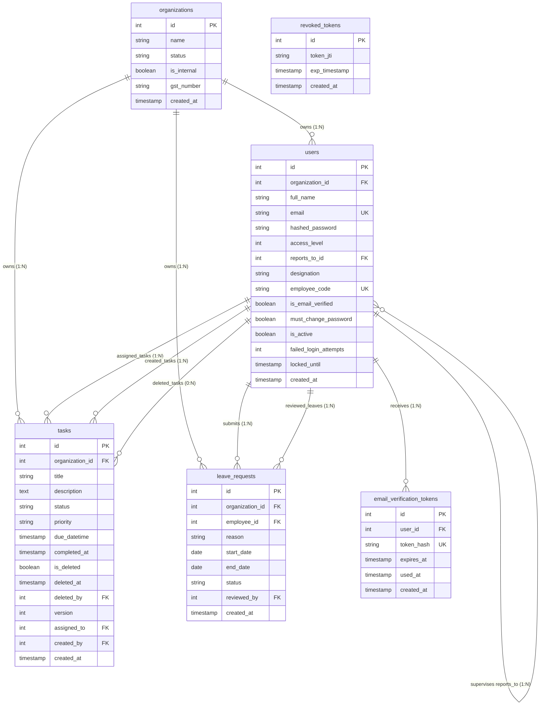

# Database Architecture & Technical Reference (`database.md`)

> **Auditor Notice**: This database audit document provides an exhaustive, field-by-field examination of the Teamloom database layer, ORM models, migration history, and data integrity guarantees. All claims are verified directly against SQLAlchemy models in `app/models/`, Alembic migrations in `alembic/versions/`, and database session configurations in `app/db/`.

---

## 1. Database Engine, ORM & Connection Architecture

### 1.1 Database Engine & Hosting
- **Database Engine**: **PostgreSQL 16** (`postgres:16-alpine` in containerized environments).
- **Hosting / Provider**:
  - *Local Development*: Docker Compose container (`db`), exposing host port `5433` mapped to internal container port `5432`.
  - *Continuous Integration (GitHub Actions)*: Docker service container running on port `5432`.
  - *Production*: Managed PostgreSQL instance (e.g., AWS RDS, Supabase, Neon, or Railway Postgres). `NFR-8` in the SaaS roadmap mandates PostgreSQL 16 parity for production hosting.

### 1.2 ORM and Query Layer
- **Object Relational Mapper (ORM)**: **SQLAlchemy 2.0** (specifically declarative 2.0 style with `Base = declarative_base()`, `Mapped`, and `mapped_column` on newer columns).
- **Driver**: **`asyncpg`** (`postgresql+asyncpg://`), an asynchronous, high-performance binary protocol driver for PostgreSQL.
- **Connection Pooling & Settings**:
  - Managed in `app/db/base.py`:
    ```python
    engine = create_async_engine(
        settings.DATABASE_URL,
        pool_pre_ping=True,  # Probes connection liveness before checkout to prevent dead connection errors
        echo=False,
    )
    AsyncSessionLocal = async_sessionmaker(
        bind=engine,
        class_=AsyncSession,
        autocommit=False,
        autoflush=False,
        expire_on_commit=False,  # Allows reading model attributes after commit without triggering lazy loads
    )
    ```
  - *Test Suite Safety*: In `tests/conftest.py`, the test engine uses `NullPool` so that async connections are strictly bound to the active test's event loop, preventing cross-test loop closure conflicts.

### 1.3 Connection Configuration & Safety Guards
- **Environment Variable**: `DATABASE_URL` loaded via Pydantic `Settings` (`app/core/config.py`).
- **Protocol Normalization**: `Settings.assemble_database_url` automatically converts legacy synchronous prefixes (`postgresql://` or `postgres://`) into `postgresql+asyncpg://`.
- **Test Database Isolation Guard**: `tests/conftest.py` executes a hard safety validation (`_validate_test_database_safety`):
  1. Refuses to run if the database name does not contain the substring `"test"`.
  2. Refuses to run if `TEST_DATABASE_URL` points to the identical database name configured in `DATABASE_URL`, preventing accidental truncation of development or production datasets.

---

## 2. Data Storage Inventory

The application stores different categories of data across dedicated infrastructure layers:

| Data Type | What Is Stored | Storage Destination | Encryption / Security |
|---|---|---|---|
| **Organizations & Tenancy** | Company name, subscription status, GST number, internal flag | PostgreSQL (`organizations` table) | Plaintext database records |
| **User Identity & Auth** | Full name, email, designation, access level, employee code, lockout counters | PostgreSQL (`users` table) | Emails lowercased & indexed; employee codes unique 10-digit |
| **Passwords** | User authentication credentials | PostgreSQL (`users.hashed_password`) | **Bcrypt** hashed with individual random salt (`gensalt()`) |
| **Email Verification Tokens** | Single-use registration activation tokens | PostgreSQL (`email_verification_tokens` table) | **SHA-256 hash** (`token_hash`); raw token never stored in DB |
| **Token Invalidation Blacklist** | Revoked JWT identifiers (`jti`) and expiry timestamps | PostgreSQL (`revoked_tokens` table) | Unique index on `token_jti`; pruned every 24h |
| **Tasks & Concurrency** | Title, description, status, priority, due datetime, completed_at, version, is_deleted, deleted_at, deleted_by | PostgreSQL (`tasks` table) | Plaintext; version checked for optimistic concurrency (409); soft delete columns (`is_deleted`, `deleted_at`, `deleted_by`) |
| **Leave Requests** | Employee ID, date range, reason string, review status, reviewer ID | PostgreSQL (`leave_requests` table) | Plaintext |
| **Rate Limit Counters** | IP request timestamps for sliding window | Process Memory (`InMemoryRateLimiter`) or Redis (`RedisRateLimiter` ZSET) | Ephemeral in-memory data (900s TTL) |
| **File Storage / Uploads** | Avatars, task attachments, documents | **None / Not Supported** | The application does not currently collect or store binary files |
| **Backups** | Point-in-time SQL and binary dumps | Local filesystem root (`backup_before_4c.sql`, `teamloom_backup_before_slice4a.dump`) | Unencrypted local files (should be moved to secure remote S3 storage) |

---

## 3. Full Table Schema Reference

The database comprises **6 application tables** (plus Alembic's internal `alembic_version` metadata table).

```
   1. organizations
   2. users
   3. tasks
   4. leave_requests
   5. email_verification_tokens
   6. revoked_tokens
```

---

### 3.1 Table: `organizations`
- **Purpose**: Multi-tenant boundary container representing client companies and internal demo workspaces.
- **ORM Model**: `Organization` (`app/models/organization.py`)
- **Migration Origin**: `alembic/versions/l2m3n4o5p6q7_add_organizations_and_backfill_data.py`

| Column Name | Data Type | Nullable | Default | Constraints & Checks |
|---|---|---|---|---|
| `id` | `INTEGER` | **No** | Auto-increment sequence | **PRIMARY KEY** |
| `name` | `VARCHAR` | **No** | None | |
| `status` | `VARCHAR(50)` | **No** | `'active'` (ORM default: `'pending_payment'`) | `CHECK (status IN ('pending_payment', 'active', 'suspended'))` (`check_org_status`) |
| `is_internal` | `BOOLEAN` | **No** | `false` | |
| `gst_number` | `VARCHAR(50)` | Yes | `NULL` | |
| `created_at` | `TIMESTAMP WITH TIME ZONE` | **No** | `NOW()` | Server default |

- **Indexes**:
  - `pk_organizations`: Primary key index on `id`.
  - `ix_organizations_id`: B-tree index on `id`.
- **Foreign Keys Outgoing**: None.
- **Referenced By (Incoming Foreign Keys)**:
  - `users.organization_id` $\rightarrow$ `organizations.id` (`ON DELETE CASCADE`)
  - `tasks.organization_id` $\rightarrow$ `organizations.id` (`ON DELETE CASCADE`)
  - `leave_requests.organization_id` $\rightarrow$ `organizations.id` (`ON DELETE CASCADE`)

---

### 3.2 Table: `users`
- **Purpose**: System accounts for all operational roles (Admins, Managers, Team Leads, Contributors).
- **ORM Model**: `User` (`app/models/user.py`)
- **Migration History**: `f2850ec5859c` (Initial) $\rightarrow$ `a1b2c3d4e5f6` $\rightarrow$ `b2c3d4e5f6g7` $\rightarrow$ `d4e5f6g7h8i9` $\rightarrow$ `e5f6g7h8i9j0` $\rightarrow$ `f6g7h8i9j0k1` $\rightarrow$ `j0k1l2m3n4o5` $\rightarrow$ `l2m3n4o5p6q7` $\rightarrow$ `m3n4o5p6q7r8` $\rightarrow$ `n4o5p6q7r8s9`

| Column Name | Data Type | Nullable | Default | Constraints & Checks |
|---|---|---|---|---|
| `id` | `INTEGER` | **No** | Auto-increment sequence | **PRIMARY KEY** |
| `full_name` | `VARCHAR` | **No** | None | |
| `email` | `VARCHAR` | **No** | None | **UNIQUE** (`uq_users_email`), Index: `ix_users_email` |
| `hashed_password` | `VARCHAR` | **No** | None | |
| `role` | `VARCHAR` (Enum `userrole`) | **No** | `'EMPLOYEE'` | DEPRECATED in code; retained for backward compatibility |
| `access_level` | `INTEGER` | **No** | `3` | `CHECK (access_level >= 1 AND access_level <= 4)` (`check_user_access_level`) |
| `reports_to_id` | `INTEGER` | Yes | `NULL` | **FOREIGN KEY** $\rightarrow$ `users.id` (`ON DELETE SET NULL`), Index: `ix_users_reports_to_id` |
| `designation` | `VARCHAR(255)` | Yes | `NULL` | |
| `employee_code` | `VARCHAR` | Yes | `NULL` | **UNIQUE** (`uq_users_employee_code`), `CHECK (employee_code IS NULL OR employee_code ~ '^[0-9]{10}$')` |
| `is_email_verified`| `BOOLEAN` | **No** | `false` | |
| `email_verified_at`| `TIMESTAMP WITH TIME ZONE` | Yes | `NULL` | |
| `must_change_password`| `BOOLEAN` | **No** | `false` | |
| `is_active` | `BOOLEAN` | **No** | `true` | |
| `failed_login_attempts`| `INTEGER` | **No** | `0` | Lockout threshold: 5 |
| `locked_until` | `TIMESTAMP WITH TIME ZONE` | Yes | `NULL` | Lockout duration: 15 minutes |
| `organization_id` | `INTEGER` | **No** | None | **FOREIGN KEY** $\rightarrow$ `organizations.id` (`ON DELETE CASCADE`), Index: `ix_users_organization_id` |
| `created_at` | `TIMESTAMP WITH TIME ZONE` | **No** | `NOW()` | Server default |

- **Indexes**:
  - `pk_users`: Primary key on `id`.
  - `ix_users_id`: B-tree index on `id`.
  - `ix_users_email`: B-tree index on `email`.
  - `ix_users_email_lower`: **Unique functional index** on `LOWER(email)` (added in `m3n4o5p6q7r8`).
  - `ix_users_employee_code`: Unique B-tree index on `employee_code`.
  - `ix_users_reports_to_id`: B-tree index on `reports_to_id` (added in `o5p6q7r8s9t0`).
  - `ix_users_organization_id`: B-tree index on `organization_id`.
- **Foreign Keys**:
  - `fk_users_reports_to_id_users`: `reports_to_id` references `users.id` (`ON DELETE SET NULL`).
  - `fk_users_organization_id_organizations`: `organization_id` references `organizations.id` (`ON DELETE CASCADE`).

---

### 3.3 Table: `tasks`
- **Purpose**: Operational tasks, assignments, deadlines, priorities, version-tracked status transitions, and soft-delete auditability.
- **ORM Model**: `Task` (`app/models/task.py`)
- **Migration History**: `f2850ec5859c` $\rightarrow$ `c3d4e5f6g7h8` $\rightarrow$ `i9j0k1l2m3n4` $\rightarrow$ `l2m3n4o5p6q7` $\rightarrow$ `o5p6q7r8s9t0` $\rightarrow$ `p6q7r8s9t0u1`

| Column Name | Data Type | Nullable | Default | Constraints & Checks |
|---|---|---|---|---|
| `id` | `INTEGER` | **No** | Auto-increment sequence | **PRIMARY KEY** |
| `title` | `VARCHAR` | **No** | None | |
| `description` | `TEXT` | **No** | None | |
| `status` | `VARCHAR` (Enum `taskstatus`) | **No** | `'PENDING'` | Values: `'PENDING'`, `'IN_PROGRESS'`, `'COMPLETED'` |
| `priority` | `VARCHAR` (Enum `taskpriority`) | **No** | None | Values: `'LOW'`, `'MEDIUM'`, `'HIGH'` |
| `due_datetime` | `TIMESTAMP WITH TIME ZONE` | **No** | None | Converted from Date to DateTime in `c3d4e5f6g7h8` |
| `completed_at` | `TIMESTAMP WITH TIME ZONE` | Yes | `NULL` | Populated automatically on status transition to COMPLETED |
| `is_deleted` | `BOOLEAN` | **No** | `false` | Soft-delete flag (added in `p6q7r8s9t0u1`). Filtered by default across all active queries |
| `deleted_at` | `TIMESTAMP WITH TIME ZONE` | Yes | `NULL` | Timestamp when soft-deleted (added in `p6q7r8s9t0u1`) |
| `deleted_by` | `INTEGER` | Yes | `NULL` | **FOREIGN KEY** $\rightarrow$ `users.id` (`ON DELETE SET NULL`), user who deleted the task (added in `p6q7r8s9t0u1`) |
| `version` | `INTEGER` | **No** | `1` | Optimistic locking counter (`version_id_col`) |
| `assigned_to` | `INTEGER` | **No** | None | **FOREIGN KEY** $\rightarrow$ `users.id` (`ON DELETE CASCADE`), Index: `ix_tasks_assigned_to` |
| `created_by` | `INTEGER` | **No** | None | **FOREIGN KEY** $\rightarrow$ `users.id` (`ON DELETE CASCADE`) |
| `organization_id` | `INTEGER` | **No** | None | **FOREIGN KEY** $\rightarrow$ `organizations.id` (`ON DELETE CASCADE`), Index: `ix_tasks_organization_id` |
| `created_at` | `TIMESTAMP WITH TIME ZONE` | **No** | `NOW()` | Server default |

- **Indexes**:
  - `pk_tasks`: Primary key on `id`.
  - `ix_tasks_id`: B-tree index on `id`.
  - `ix_tasks_assigned_to`: B-tree index on `assigned_to` (added in `o5p6q7r8s9t0`).
  - `ix_tasks_organization_id`: B-tree index on `organization_id`.
  - `ix_tasks_organization_id_status`: Composite B-tree index on `(organization_id, status)` (added in `o5p6q7r8s9t0`).
- **Foreign Keys**:
  - `fk_tasks_assigned_to_users`: `assigned_to` references `users.id` (`ON DELETE CASCADE`).
  - `fk_tasks_created_by_users`: `created_by` references `users.id` (`ON DELETE CASCADE`).
  - `fk_tasks_organization_id_organizations`: `organization_id` references `organizations.id` (`ON DELETE CASCADE`).
  - `fk_tasks_deleted_by_users`: `deleted_by` references `users.id` (`ON DELETE SET NULL`).

---

### 3.4 Table: `leave_requests`
- **Purpose**: Absence management records, date intervals, and administrative approvals.
- **ORM Model**: `LeaveRequest` (`app/models/leave.py`)
- **Migration History**: `f2850ec5859c` $\rightarrow$ `l2m3n4o5p6q7`

| Column Name | Data Type | Nullable | Default | Constraints & Checks |
|---|---|---|---|---|
| `id` | `INTEGER` | **No** | Auto-increment sequence | **PRIMARY KEY** |
| `employee_id` | `INTEGER` | **No** | None | **FOREIGN KEY** $\rightarrow$ `users.id` (`ON DELETE CASCADE`), Index: `ix_leave_requests_employee_id` |
| `reason` | `VARCHAR` | **No** | None | |
| `start_date` | `DATE` | **No** | None | Validated in service: `start_date <= end_date` |
| `end_date` | `DATE` | **No** | None | |
| `status` | `VARCHAR` (Enum `leavestatus`) | **No** | `'PENDING'` | Values: `'PENDING'`, `'APPROVED'`, `'REJECTED'` |
| `reviewed_by` | `INTEGER` | Yes | `NULL` | **FOREIGN KEY** $\rightarrow$ `users.id` (`ON DELETE SET NULL`) |
| `organization_id` | `INTEGER` | **No** | None | **FOREIGN KEY** $\rightarrow$ `organizations.id` (`ON DELETE CASCADE`), Index: `ix_leave_requests_organization_id` |
| `created_at` | `TIMESTAMP WITH TIME ZONE` | **No** | `NOW()` | Server default |

- **Indexes**:
  - `pk_leave_requests`: Primary key on `id`.
  - `ix_leave_requests_id`: B-tree index on `id`.
  - `ix_leave_requests_employee_id`: B-tree index on `employee_id` (added in `o5p6q7r8s9t0`).
  - `ix_leave_requests_organization_id`: B-tree index on `organization_id`.
  - `ix_leave_requests_organization_id_status`: Composite B-tree index on `(organization_id, status)` (added in `o5p6q7r8s9t0`).
- **Foreign Keys**:
  - `fk_leave_requests_employee_id_users`: `employee_id` references `users.id` (`ON DELETE CASCADE`).
  - `fk_leave_requests_reviewed_by_users`: `reviewed_by` references `users.id` (`ON DELETE SET NULL`).
  - `fk_leave_requests_organization_id_organizations`: `organization_id` references `organizations.id` (`ON DELETE CASCADE`).

---

### 3.5 Table: `email_verification_tokens`
- **Purpose**: Secure, single-use activation tokens issued during company signup or resend workflows.
- **ORM Model**: `EmailVerificationToken` (`app/models/email_verification_token.py`)
- **Migration Origin**: `alembic/versions/m3n4o5p6q7r8_slice4a_user_ids_email_verification.py`

| Column Name | Data Type | Nullable | Default | Constraints & Checks |
|---|---|---|---|---|
| `id` | `INTEGER` | **No** | Auto-increment sequence | **PRIMARY KEY** |
| `user_id` | `INTEGER` | **No** | None | **FOREIGN KEY** $\rightarrow$ `users.id` (`ON DELETE CASCADE`), Index: `ix_email_verification_tokens_user_id` |
| `token_hash` | `VARCHAR(64)` | **No** | None | **UNIQUE** (`uq_email_verification_tokens_token_hash`), Index: `ix_email_verification_tokens_token_hash` |
| `expires_at` | `TIMESTAMP WITH TIME ZONE` | **No** | None | 24-hour expiry from issuance |
| `used_at` | `TIMESTAMP WITH TIME ZONE` | Yes | `NULL` | Populated when token is successfully consumed |
| `created_at` | `TIMESTAMP WITH TIME ZONE` | **No** | `NOW()` | Server default |

- **Indexes**:
  - `pk_email_verification_tokens`: Primary key on `id`.
  - `ix_email_verification_tokens_id`: B-tree index on `id`.
  - `ix_email_verification_tokens_user_id`: B-tree index on `user_id`.
  - `ix_email_verification_tokens_token_hash`: Unique B-tree index on `token_hash`.
- **Foreign Keys**:
  - `fk_email_verification_tokens_user_id_users`: `user_id` references `users.id` (`ON DELETE CASCADE`).

---

### 3.6 Table: `revoked_tokens`
- **Purpose**: Blacklist of revoked JWT token identifiers (`jti`) ensuring immediate server-side revocation on logout or token rotation.
- **ORM Model**: `RevokedToken` (`app/models/revoked_token.py`)
- **Migration History**: `g7h8i9j0k1l2` (Created) $\rightarrow$ `104551d9fda5` (Unique constraint dropped, replaced with B-tree index)

| Column Name | Data Type | Nullable | Default | Constraints & Checks |
|---|---|---|---|---|
| `id` | `INTEGER` | **No** | Auto-increment sequence | **PRIMARY KEY** |
| `token_jti` | `VARCHAR(255)` | **No** | None | Index: `ix_revoked_tokens_token_jti` |
| `exp_timestamp`| `TIMESTAMP WITH TIME ZONE` | **No** | None | Index: `ix_revoked_tokens_exp_timestamp` |
| `created_at` | `TIMESTAMP WITH TIME ZONE` | **No** | `NOW()` | Server default |

- **Indexes**:
  - `pk_revoked_tokens`: Primary key on `id`.
  - `ix_revoked_tokens_id`: B-tree index on `id`.
  - `ix_revoked_tokens_token_jti`: B-tree index on `token_jti`.
  - `ix_revoked_tokens_exp_timestamp`: B-tree index on `exp_timestamp` (used by cleanup query).
- **Foreign Keys**: None (stateless JWT revocation).

---

## 4. Entity Relationships & Business Rationale



### Explanation of Relationships Based on Business Logic:

1. **`Organization` $\rightarrow$ `User` (One-to-Many, Mandatory)**:
   - *Why*: Every employee and administrator belongs strictly to one company (Decision `A5`). Deleting an organization cascades and removes all employee records.
2. **`Organization` $\rightarrow$ `Task` (One-to-Many, Mandatory)**:
   - *Why*: Tasks belong to the organization workspace (`A1`). Direct organization pointers allow high-efficiency tenant filtering and prevent task isolation leaks if an employee leaves or is reassigned.
3. **`Organization` $\rightarrow$ `LeaveRequest` (One-to-Many, Mandatory)**:
   - *Why*: Leave schedules are company assets. Direct scoping allows Tier-1 Admins to review company-wide absences without joining the user table.
4. **`User` $\rightarrow$ `User` (`reports_to_id`, Self-Referential One-to-Many, Optional)**:
   - *Why*: Establishes the management hierarchy. Enables managers and team leads to view direct reports' tasks and absences, and restricts task creation authority to direct subordinates. If a manager is deleted, `ondelete="SET NULL"` preserves the subordinate employee accounts without leaving dangling pointers.
5. **`User` $\rightarrow$ `Task` (`assigned_to`, One-to-Many, Mandatory)**:
   - *Why*: Every task has exactly one assignee responsible for execution. If the assignee user is deleted, associated tasks are cascaded (`ondelete="CASCADE"`).
6. **`User` $\rightarrow$ `Task` (`created_by`, One-to-Many, Mandatory)**:
   - *Why*: Tracks audit origin (who delegated the task).
7. **`User` $\rightarrow$ `LeaveRequest` (`employee_id`, One-to-Many, Mandatory)**:
   - *Why*: Associates the leave request with the employee requesting absence.
8. **`User` $\rightarrow$ `LeaveRequest` (`reviewed_by`, One-to-Many, Optional)**:
   - *Why*: Captures the specific Tier-1 Admin who approved or rejected the leave request. `SET NULL` prevents deletion of an admin from invalidating historical leave audit records.
9. **`User` $\rightarrow$ `EmailVerificationToken` (One-to-Many, Mandatory)**:
   - *Why*: Allows issuing multiple tokens over time (signup, resend) while maintaining a strict historical audit of when each token was generated, used, or invalidated.

---

## 5. Migrations & Schema Drift Audit

The migration chain consists of **18 linear revisions** managed via Alembic:

| Step | Revision ID | Down Revision | Script File | Summary of Changes |
|:---:|---|---|---|---|
| 01 | `f2850ec5859c` | `None` | `f2850ec5859c_initial_migration.py` | Initial schema: `users`, `tasks`, `leave_requests` |
| 02 | `a1b2c3d4e5f6` | `f2850ec5859c` | `a1b2c3d4e5f6_add_manager_id_to_users.py` | Added `manager_id` foreign key to `users` |
| 03 | `b2c3d4e5f6g7` | `a1b2c3d4e5f6` | `b2c3d4e5f6g7_add_employee_code_and_must_change_password.py` | Added `employee_code` and `must_change_password` |
| 04 | `c3d4e5f6g7h8` | `b2c3d4e5f6g7` | `c3d4e5f6g7h8_convert_due_date_to_due_datetime_add_completed_at.py` | Converted `due_date` $\rightarrow$ `due_datetime`, added `completed_at` |
| 05 | `d4e5f6g7h8i9` | `c3d4e5f6g7h8` | `d4e5f6g7h8i9_add_account_lockout_columns_to_users.py` | Added `failed_login_attempts` & `locked_until` |
| 06 | `e5f6g7h8i9j0` | `d4e5f6g7h8i9` | `e5f6g7h8i9j0_rename_manager_id_to_reports_to_id_and_add_designation.py` | Renamed `manager_id` $\rightarrow$ `reports_to_id`, added `designation` |
| 07 | `f6g7h8i9j0k1` | `e5f6g7h8i9j0` | `f6g7h8i9j0k1_add_is_active_column_to_users.py` | Added `is_active` soft-deactivation column |
| 08 | `g7h8i9j0k1l2` | `f6g7h8i9j0k1` | `g7h8i9j0k1l2_add_revoked_tokens_table.py` | Created `revoked_tokens` blacklist table |
| 09 | `h8i9j0k1l2m3` | `g7h8i9j0k1l2` | `h8i9j0k1l2m3_add_employee_code_seq.py` | Created PostgreSQL sequence `employee_code_seq` |
| 10 | `i9j0k1l2m3n4` | `h8i9j0k1l2m3` | `i9j0k1l2m3n4_add_version_to_tasks.py` | Added integer `version` column to `tasks` |
| 11 | `104551d9fda5` | `i9j0k1l2m3n4` | `104551d9fda5_add_version_column_to_tasks_for_.py` | **Misnamed file**: actually made `employee_code` nullable & dropped unique constraint on `revoked_tokens.token_jti` |
| 12 | `j0k1l2m3n4o5` | `104551d9fda5` | `j0k1l2m3n4o5_add_access_level_tier_system.py` | Added `access_level` (1-4) check constraint to `users` |
| 13 | `k1l2m3n4o5p6` | `j0k1l2m3n4o5` | `k1l2m3n4o5p6_sync_employee_code_seq.py` | Resynced `employee_code_seq` to max existing ID |
| 14 | `l2m3n4o5p6q7` | `k1l2m3n4o5p6` | `l2m3n4o5p6q7_add_organizations_and_backfill_data.py` | Added `organizations`, added `organization_id` to tables, backfilled default org |
| 15 | `m3n4o5p6q7r8` | `l2m3n4o5p6q7` | `m3n4o5p6q7r8_slice4a_user_ids_email_verification.py` | 10-digit random IDs, dropped `employee_code_seq`, added `email_verification_tokens`, lower(email) index |
| 16 | `n4o5p6q7r8s9` | `m3n4o5p6q7r8` | `n4o5p6q7r8s9_slice4c_backfill_email_verification.py` | Backfilled `is_email_verified = true` for legacy accounts |
| 17 | `o5p6q7r8s9t0` | `n4o5p6q7r8s9` | `o5p6q7r8s9t0_add_missing_indexes_for_performance.py` | Added missing query & foreign key indexes: `ix_tasks_assigned_to`, `ix_tasks_organization_id_status`, `ix_leave_requests_employee_id`, `ix_leave_requests_organization_id_status`, `ix_users_reports_to_id` |
| 18 | `p6q7r8s9t0u1` | `o5p6q7r8s9t0` | `p6q7r8s9t0u1_add_soft_delete_to_tasks.py` | Added soft-delete columns to `tasks` (`is_deleted`, `deleted_at`, `deleted_by`) with FK to `users.id` (`ON DELETE SET NULL`) |

### Identified Migration Drift & Anomalies:
1. **Critical File Misnaming Anomaly (`104551d9fda5`)**:
   - **File Path**: `alembic/versions/104551d9fda5_add_version_column_to_tasks_for_.py`
   - **Discrepancy**: The filename suggests it adds the `tasks.version` column. However, `tasks.version` was already added in the preceding migration (`i9j0k1l2m3n4_add_version_to_tasks.py`).
   - **Actual SQL Operations in File**:
     - Line 24: `op.drop_constraint(op.f('revoked_tokens_token_jti_key'), 'revoked_tokens', type_='unique')`
     - Lines 25-27: `op.alter_column('users', 'employee_code', existing_type=sa.VARCHAR(), nullable=True)`
   - **Internal Docstring**: `"alter users employee_code nullable and drop revoked_tokens jti unique constraint"`
   - **CRITICAL OPERATIONAL RULE**: **DO NOT rename or edit this migration file**. Alembic tracks applied migrations by the exact revision string (`104551d9fda5`) stored in the database's `alembic_version` table and the `down_revision` pointers of child migration `j0k1l2m3n4o5`. Renaming or deleting the file will break migration graph resolution on existing databases and in CI/CD pipelines. This must remain as documented technical debt.
2. **PostgreSQL Sequence Dropped (`employee_code_seq`)**:
   - Created in `h8i9j0k1l2m3` and synced in `k1l2m3n4o5p6`.
   - Intentionally dropped in `m3n4o5p6q7r8` because Slice 4a transitioned to 10-digit random numeric codes generated in Python (`secrets.randbelow(10**10)`).
   - If rolling back through Alembic downgrade, `m3n4o5p6q7r8` recreates the sequence, but cannot restore old `EMP-` formatted codes.
3. **ORM Model vs Migration Default Mismatch (`organizations.status`)**:
   - In `app/models/organization.py`, the ORM default is `OrgStatus.ACTIVE.value`.
   - In `app/services/auth_service.py`, new signups explicitly set `OrgStatus.PENDING_PAYMENT.value`.
   - In the database schema, there is no SQL `DEFAULT` clause on `organizations.status`.

---

## 6. Multi-Tenancy Architecture

### 6.1 Multi-Tenancy Model
- **Pattern**: **Shared Database, Shared Schema, Row-Level Tenant Identifier (`organization_id`)**.
- **Isolation Enforcement**:
  - Enforced in the application layer via `app/services/common.py` (`get_scoped_or_404`).
  - Every SQL query on `users`, `tasks`, and `leave_requests` explicitly injects `Model.organization_id == actor.organization_id`.
  - Cross-tenant requests referencing an ID from another organization raise `ResourceNotFoundException` returning HTTP 404 (not 403), ensuring complete anti-enumeration so attackers cannot confirm the existence of competitor records (Decision `X4`).
- **Default Organization**:
  - Migration `l2m3n4o5p6q7` seeded `'Internal / free forever'` (`id = 1`, `is_internal = true`).
  - Pre-existing tasks, leaves, and users were backfilled into this organization.
  - New self-serve signups create distinct, isolated organizations.

---

## 7. Row-Level Security (RLS) Status
- **Current Status**: **Not implemented at the PostgreSQL database engine level**.
- **Evidence**: `docs/TEAMLOOM_SAAS_REQUIREMENTS.md` section 6 explicitly records: `"Row-level security in the database: Out of Scope (this stage)"`.
- **Implication**: All data isolation relies strictly on application-level filtering (`WHERE organization_id = :org_id`). If an engineer writes a raw SQL query or bypasses `get_scoped_or_404`, data leakage is possible. Adding PostgreSQL native Row Level Security policies (`ALTER TABLE tasks ENABLE ROW LEVEL SECURITY; CREATE POLICY tenant_isolation...`) is recommended before expanding team development.

---

## 8. Data Integrity & Operational Risks

### 8.1 Missing Indexes (Resolved in `o5p6q7r8s9t0`)
All missing foreign key and composite query indexes identified in the initial audit were implemented in migration `o5p6q7r8s9t0`:
- **`tasks.assigned_to`**: Indexed via `ix_tasks_assigned_to`. Optimizes personal dashboard task lookups (`/dashboard`), team task filtering (`/my-team`), and foreign key cascade deletion locks.
- **`tasks(organization_id, status)`**: Indexed via composite `ix_tasks_organization_id_status`. Optimizes administrative task filtering by status across large tenant organizations.
- **`leave_requests.employee_id`**: Indexed via `ix_leave_requests_employee_id`. Optimizes personal leave history queries and leave overlap checks.
- **`leave_requests(organization_id, status)`**: Indexed via composite `ix_leave_requests_organization_id_status`. Optimizes the administrative leave review queue (`/admin/leaves?status=PENDING`).
- **`users.reports_to_id`**: Indexed via `ix_users_reports_to_id`. Optimizes hierarchy lookups, direct reports resolution, team hubs, and supervisory reporting chain updates.
- **Index Evaluation on `is_deleted`**: Evaluated whether `ix_tasks_assigned_to` and `ix_tasks_organization_id_status` remain optimal with the `is_deleted` filter. Both indexes remain optimal without modification: `assigned_to` and `(organization_id, status)` provide high cardinality filtering, while `is_deleted` is a low-cardinality boolean where the vast majority of records are active (`false`). Adding `is_deleted` to composite indexes or creating partial indexes (`WHERE is_deleted = false`) would add index bloat and maintenance overhead without meaningful selectivity gains, and `ix_tasks_assigned_to` is also required for foreign key cascade checks. No speculative indexes were added.

### 8.2 Soft Deletion on Core Entities (Tasks Resolved in `feat/soft-delete-tasks` / `p6q7r8s9t0u1`)
- **Tasks (RESOLVED)**: `DELETE /tasks/{id}` executes soft-deletion (`is_deleted = True`, `deleted_at = datetime.now(UTC)`, `deleted_by = user.id`) in a single atomic transaction and bumps `version` to preserve optimistic locking integrity. Soft-deleted tasks are hidden by default across all active queries (lists, single fetch 404 via `get_scoped_or_404`, team views, dashboards, analytics counts and milestone trail, pagination totals `X-Total-Count`). Soft-deleted tasks cannot be modified or updated.
- **Leaves (DEFERRED)**: Leave soft-deletion is deferred because no real leave deletion flow exists today in Teamloom; administrative approvals, rejections, and cancellations are explicit status transitions on `leave_requests`.

### 8.3 Deactivation Hierarchy Protection (Resolved in `fix/supervisor-deactivation`)
- Previously, `deactivate_user` silently executed a bulk update nulling `reports_to_id` on all direct reports.
- Resolved: Deactivation now strictly validates subordinate reassignments in a single atomic transaction. If active direct reports are not resolved, the operation aborts with HTTP 409 Conflict without altering database state. Reactivation does not need to restore links because active links are never silently wiped.

### 8.4 User ID Random Collision Loop Cap
- User IDs are 10-digit random strings (`secrets.randbelow(10**10)`).
- Collisions are caught via `try...except IntegrityError` with `max_attempts = 10`.
- While a 10-digit space ($10^{10} = 10 \text{ billion}$) makes collision unlikely for small datasets, if 10 consecutive collisions occur, `AppException` is raised and employee creation fails.

